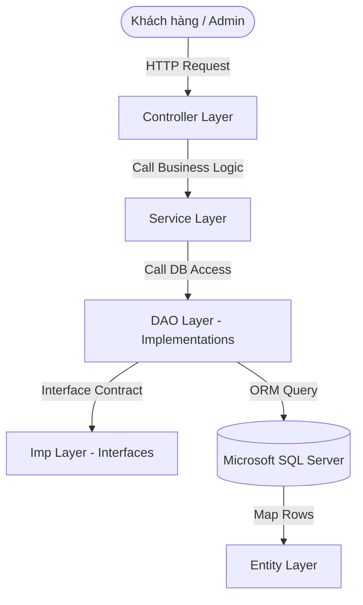

# 👕 Dự Án Quản Lý Web Áo Quần (QuanLyWebaoQuan)

Dự án **QuanLyWebaoQuan** là một ứng dụng web hoàn chỉnh phục vụ cho việc quản lý và kinh doanh thời trang (quần áo) trực tuyến. Hệ thống được phát triển dựa trên mô hình **MVC (Model-View-Controller)** sử dụng framework **Spring Boot** kết hợp với cơ sở dữ liệu **Microsoft SQL Server** và giao diện **JSP (JavaServer Pages)**.

---

## 🛠️ Công Nghệ Sử Dụng (Tech Stack)

### Backend
*   **Ngôn ngữ chính:** Java 21
*   **Framework:** Spring Boot 3.5.12 (Spring Web, Spring Data JPA, Spring Mail)
*   **ORM / Database Access:** Hibernate / JPA (EntityManager custom DAOs)
*   **Thư viện hỗ trợ:** Lombok 1.18.42 (giúp tinh gọn code boilerplate)
*   **JSON Parser:** Google Gson (xử lý dữ liệu JSON dạng chuỗi)
*   **Format code:** Spotless Plugin với Google Java Format

### Database
*   **Hệ quản trị CSDL:** Microsoft SQL Server
*   **Kết nối CSDL:** `mssql-jdbc`
*   **Tính năng tự động tạo bảng:** `hibernate.hbm2ddl.auto=update`

### Giao Diện (Frontend)
*   **Template Engine:** JSP (JavaServer Pages) hỗ trợ qua Tomcat Embed Jasper
*   **Thư viện tag:** Jakarta Standard Tag Library (JSTL) API & Glassfish JSTL implementation
*   **Rich Text Editor:** Tích hợp CKEditor hỗ trợ viết mô tả sản phẩm phong phú
*   **Giao diện tĩnh:** Tách biệt tài nguyên CSS, JS và hình ảnh dành cho phân hệ `user` và `admin` tại thư mục `/resourcess/`

### Kiểm Thử (Unit Testing)
*   **Framework chính:** JUnit 5 (JUnit Jupiter)
*   **Giả lập:** Mockito (hỗ trợ cô lập các tầng dịch vụ và controller)
*   **Kiểm thử Web:** Spring Boot Test & MockMvc
*   **Cơ sở dữ liệu in-memory:** H2 Database (hỗ trợ chạy test database không cần SQL Server thực tế)

---

## 🏗️ Kiến Trúc Hệ Thống (System Architecture)

Dự án tuân thủ mô hình phân tầng chuẩn trong phát triển ứng dụng Spring Boot:



1.  **Entity Layer (`com.banhang.entity`):** Định nghĩa các thực thể ánh xạ trực tiếp đến các bảng trong CSDL sử dụng các annotation JPA (`@Entity`, `@Table`, `@Id`, `@Column`, `@ManyToOne`, v.v.).
2.  **Imp Layer (`com.banhang.imp`):** Tập hợp các Interface định nghĩa khuôn mẫu và các phương thức cần có cho các thao tác CSDL.
3.  **DAO Layer (`com.banhang.dao`):** Hiện thực các Interface trong tầng Imp, trực tiếp thao tác với cơ sở dữ liệu thông qua `@PersistenceContext EntityManager`.
4.  **Service Layer (`com.banhang.service`):** Xử lý nghiệp vụ logic (Business Logic), trung chuyển dữ liệu giữa Controller và DAO, quản lý giao dịch (`@Transactional`).
5.  **Controller Layer (`com.banhang.controller`):** Tiếp nhận yêu cầu từ client, gọi tầng Service xử lý và điều hướng hiển thị kết quả ra giao diện JSP tương ứng.
    *   `admin/`: Phân hệ quản trị dành cho nhân viên/quản lý.
    *   `user/`: Phân hệ dành cho khách mua sắm.

Phân hệ khách hàng hỗ trợ cập nhật hồ sơ và mật khẩu, xem lịch sử/chi tiết đơn hàng, hủy đơn đang chờ xác nhận, và gửi yêu cầu đổi/trả trong 30 ngày từ khi hoàn thành đơn. Yêu cầu đổi có thể chọn biến thể màu/kích cỡ thay thế; quản trị viên xem và tiếp nhận hoặc từ chối yêu cầu tại trang quản trị.

---

## 📂 Cấu Trúc Thư Mục Dự Án

```text
QuanLyWebaoQuan/
├── .settings/                # Cấu hình IDE (Eclipse/VS Code)
├── src/
│   ├── main/
│   │   ├── java/com/banhang/
│   │   │   ├── Application.java       # File kích hoạt ứng dụng Spring Boot
│   │   │   ├── commons/              # Các hàm dùng chung (tiện ích)
│   │   │   ├── config/               # Cấu hình hệ thống (WebConfig, Spring Security, v.v.)
│   │   │   ├── controller/           # Tầng điều khiển (phân chia admin và user)
│   │   │   ├── dao/                  # Tầng truy xuất cơ sở dữ liệu (EntityManager)
│   │   │   ├── entity/               # Thực thể ánh xạ CSDL JPA
│   │   │   ├── imp/                  # Giao diện (Interface) định nghĩa hành vi DAO
│   │   │   ├── model/                # Data Transfer Objects (DTO) hoặc View Model
│   │   │   └── service/              # Tầng xử lý nghiệp vụ
│   │   ├── resources/
│   │   │   └── application.properties # Cấu hình kết nối CSDL, Mail, Port, View Resolver
│   │   └── webapp/
│   │       ├── resourcess/           # Assets tĩnh (admin, user CSS/JS, CKEditor)
│   │       └── WEB-INF/
│   │           ├── web.xml           # Cấu hình Servlet Web (kích hoạt DispatcherServlet)
│   │           └── view/
│   │               ├── admin/       # JSP dành riêng cho quản trị viên
│   │               ├── user/        # JSP dành riêng cho khách hàng
│   │               ├── 401.jsp      # Trang lỗi dùng chung
│   │               └── 404.jsp      # Trang lỗi dùng chung
│   └── test/
│       └── java/com/banhang/
│           ├── controller/user/
│           │   └── TrangChuUserControllerTest.java # Test MockMvc cho controller
│           ├── entity/
│           │   └── ChiTietHoaDonIdTest.java        # Test POJO/class thông thường
│           └── service/
│               └── SanPhamServiceTest.java         # Test nghiệp vụ sử dụng Mockito mock DAO
├── pom.xml                   # Cấu hình quản lý thư viện Maven
└── README.md                 # Tài liệu hướng dẫn sử dụng và giới thiệu dự án
```

---

## 🗄️ Mô Hình Dữ Liệu & Các Thực Thể Chính

Hệ thống được thiết kế chặt chẽ với các thực thể liên kết sau:

*   **Sản Phẩm (`SanPham`):** Chứa thông tin cơ bản về quần áo như tên, giá bán, hình ảnh mô tả, và danh mục.
*   **Chi Tiết Sản Phẩm (`ChiTietSanPham`):** Phân rã thuộc tính cụ thể của sản phẩm theo **Màu sắc (`MauSanPham`)** và **Kích thước (`SizeSanPham`)** cùng số lượng tồn kho tương ứng.
*   **Danh Mục (`DanhMucSanPham`):** Quản lý phân loại sản phẩm (ví dụ: Áo thun, Quần jeans, Váy đầm).
*   **Khách Hàng / Nhân Viên (`NhanVien`, `ChucVu`):** Hệ thống tài khoản người dùng và phân quyền (như Admin, Nhân viên bán hàng, Khách hàng).
*   **Giỏ Hàng (`GioHang`):** Quản lý tạm thời các mặt hàng người dùng chọn mua trước khi tiến hành thanh toán.
*   **Hóa Đơn & Chi Tiết (`HoaDon`, `ChiTietHoaDon`):** Lưu trữ thông tin đơn hàng, tổng tiền, ngày mua, và danh sách sản phẩm cùng số lượng của đơn hàng đó.
*   **Khuyến Mãi & Chi Tiết (`KhuyenMai`, `ChiTietKhuyenMai`):** Các chương trình giảm giá được áp dụng lên sản phẩm.

---

## 🚀 Hướng Dẫn Chạy Dự Án

### 1. Chuẩn Bị Môi Trường
*   Cài đặt **Java Development Kit (JDK) 21**.
*   Cài đặt **Microsoft SQL Server** và khởi tạo cơ sở dữ liệu tên là `dbbanhang`.
*   Công cụ lập trình (IDE): IntelliJ IDEA, Eclipse, hoặc VS Code.

### 2. Cấu Hình Cơ Sở Dùi Liệu
Mở file [application.properties](file:///D:/Developer/Data-VSCode/QuanLyWebaoQuan/src/main/resources/application.properties) và chỉnh sửa thông tin kết nối SQL Server của bạn:
```properties
spring.datasource.url=jdbc:sqlserver://localhost:1433;databaseName=dbbanhang;encrypt=true;trustServerCertificate=true;
spring.datasource.username=YOUR_USERNAME
spring.datasource.password=YOUR_PASSWORD
```

### 3. Chạy Unit Test
Để chạy toàn bộ Unit Test cho Controller, Service và Entity, đồng thời tạo báo cáo HTML, chạy tại thư mục gốc dự án:
```bash
mvn -B clean test
```

Sau khi chạy thành công, mở báo cáo chi tiết tại `target/reports/surefire.html` bằng trình duyệt. Maven cũng lưu kết quả kiểm thử dạng XML trong `target/surefire-reports/`.

Nếu test thất bại, Maven có thể dừng trước khi tạo báo cáo HTML. Có thể tạo báo cáo từ kết quả XML đã có bằng lệnh:
```bash
mvn -B surefire-report:report
```

### 4. Kiểm Tra Bắt Buộc Trước Khi Commit
Trước khi commit mã nguồn, hãy chạy lần lượt các bước sau tại thư mục gốc dự án. Chỉ commit khi tất cả bước kiểm tra đều thành công.

**Bước 1 — Tự động định dạng mã Java bằng Spotless:**
```bash
mvn -B spotless:apply
```

**Bước 2 — Kiểm tra mã đã đúng định dạng, không tự sửa file:**
```bash
mvn -B spotless:check
```
Nếu bước này thất bại, chạy lại `mvn -B spotless:apply`, sau đó chạy lại bước kiểm tra.

**Bước 3 — Chạy toàn bộ Unit Test local và tạo báo cáo:**
```bash
mvn -B clean test
```
Lệnh này xóa kết quả build cũ, chạy test và tạo báo cáo HTML tại `target/reports/surefire.html`. Nếu có test thất bại, không tiếp tục commit cho đến khi đã xử lý và chạy lại thành công.

**Bước 4 — Kiểm tra khoảng trắng và xem lại các thay đổi trước khi đưa vào commit:**
```bash
git diff --check
git status
git diff
```

Sau khi các bước trên đều thành công, mới stage và commit các file thuộc thay đổi của bạn:
```bash
git add <đường-dẫn-file>
git commit -m "Mô tả ngắn gọn thay đổi"
```

### 5. Build và Chạy Ứng Dụng
Sử dụng Maven để build dự án thành file `.war` hoặc khởi chạy trực tiếp thông qua Spring Boot.

*   Chạy bằng lệnh Maven trên terminal:
    ```bash
    mvn clean spring-boot:run
    ```
*   Sau khi ứng dụng khởi chạy thành công, truy cập giao diện tại:
    *   **Trang chủ người dùng (User Storefront):** `http://localhost:8080/`
    *   **Trang quản trị (Admin Dashboard):** `http://localhost:8080/admin`
    *   **Báo cáo thống kê (Admin):** `http://localhost:8080/admin/reports`

### 6. Lọc Sản Phẩm và Dữ Liệu Mẫu
Trang chủ và trang chi tiết sản phẩm hỗ trợ lọc sản phẩm theo danh mục, từ khóa tên/mã sản phẩm và khoảng giá. Ở trang chi tiết, áp dụng bộ lọc sẽ mở danh sách kết quả tại trang chủ. Có thể kết hợp các bộ lọc; để xóa bộ lọc, chọn **Xóa bộ lọc**. Danh sách được phân trang, mỗi trang hiển thị tối đa 9 sản phẩm; các điều kiện lọc được giữ nguyên khi chuyển trang.

`data.sql` tạo 60 sản phẩm và biến thể mẫu bổ sung bên cạnh 4 sản phẩm ban đầu (tổng cộng 64 sản phẩm), giúp kiểm tra phân loại, tìm kiếm, giá và tồn kho trên giao diện. Script dữ liệu được Spring Boot thực thi khi khởi động theo cấu hình hiện tại; chỉ sử dụng với cơ sở dữ liệu phát triển/thử nghiệm, không chạy trên cơ sở dữ liệu cần giữ dữ liệu.

### 7. Giao Diện Báo Cáo Quản Trị
Đăng nhập bằng tài khoản admin rồi mở `/admin/reports`. Dashboard tải số liệu qua các API thống kê, hỗ trợ chọn khoảng ngày và hiển thị doanh thu, đơn hoàn thành, số lượng bán, lợi nhuận gộp, sản phẩm bán chạy/nhập nhiều và tồn kho. Giá vốn/lợi nhuận chỉ có ý nghĩa khi dữ liệu giá vốn đã được nhập.

## 📊 API Thống Kê và Quản Lý Kho

Các API dưới đây dành cho tài khoản quản trị (`taikhoan` có chức vụ admin) và trả JSON. Ngày dùng định dạng `yyyy-MM-dd`; nếu lọc theo khoảng tùy chọn, phải truyền đồng thời `startDate` và `endDate`, trong đó ngày kết thúc được tính bao gồm. Có thể dùng `year`, kết hợp với `month` hoặc `quarter`; không kết hợp các tham số này với khoảng ngày. Khi không truyền bộ lọc thời gian, API báo cáo mặc định kỳ hiện tại.

### Báo cáo

| Method | Endpoint | Query parameters chính |
| --- | --- | --- |
| GET | `/api/reports/revenue/summary` | `startDate`, `endDate` hoặc `year`, `month`, `quarter` |
| GET | `/api/reports/revenue/by-day` | `startDate`, `endDate` hoặc `year`, `month` |
| GET | `/api/reports/revenue/by-month` | `startDate`, `endDate` hoặc `year` |
| GET | `/api/reports/revenue/by-quarter` | `startDate`, `endDate` hoặc `year` |
| GET | `/api/reports/revenue/by-year` | `startDate`, `endDate` |
| GET | `/api/reports/products/best-selling` | Bộ lọc thời gian, `categoryId`, `search`, `sortBy` (`revenue`/`quantity`), `page`, `size` |
| GET | `/api/reports/products/most-imported` | Bộ lọc thời gian, `categoryId`, `supplierId`, `search`, `page`, `size` |
| GET | `/api/reports/inventory/summary` | `categoryId`, `zeroStock`, `lowStock`, `page`, `size` |
| GET | `/api/reports/products/low-stock` | `categoryId`, `page`, `size` |
| GET | `/api/reports/products/slow-moving` | Bộ lọc thời gian, `categoryId`, `search`, `page`, `size` |
| GET | `/api/reports/inventory/movements` | `startDate`, `endDate`, `variantId`, `page`, `size` |

Ví dụ:

```text
GET /api/reports/revenue/summary?startDate=2026-01-01&endDate=2026-01-31
GET /api/reports/products/best-selling?year=2026&quarter=1&sortBy=quantity&page=0&size=10
GET /api/reports/inventory/summary?categoryId=2&lowStock=true
```

Danh sách báo cáo được phân trang (`page` bắt đầu từ 0, `size` từ 1 đến 100; mặc định tùy endpoint). Lỗi đầu vào/đăng nhập trả JSON có thời điểm, HTTP status, thông điệp và URI.

### Nghiệp vụ nhà cung cấp, nhập kho và điều chỉnh kho

| Method | Endpoint | Mô tả |
| --- | --- | --- |
| GET | `/api/inventory/suppliers` | Danh sách nhà cung cấp |
| POST | `/api/inventory/suppliers` | Tạo nhà cung cấp |
| POST | `/api/inventory/receipts` | Tạo phiếu nhập nháp |
| POST | `/api/inventory/receipts/{id}/confirm` | Xác nhận phiếu nhập và cộng tồn |
| DELETE | `/api/inventory/receipts/{id}` | Hủy phiếu nhập nháp |
| POST | `/api/inventory/opening-balances` | Ghi tồn đầu kỳ và giá vốn cho biến thể |
| POST | `/api/inventory/adjustments` | Điều chỉnh tăng/giảm tồn có ghi lịch sử |
| POST | `/api/orders/{id}/cancel` | Hủy đơn chờ xử lý/đã duyệt và hoàn lại tồn |
| POST | `/api/orders/{id}/refunds` | Tạo giao dịch hoàn tiền, phân bổ theo biến thể hàng |
| POST | `/api/orders/{id}/returns` | Ghi nhận hàng khách trả và nhập lại kho |

Ví dụ tạo phiếu nhập nháp:

```json
{
  "supplierId": 1,
  "items": [
    { "variantId": 12, "quantity": 20, "unitCost": 85000.00 }
  ]
}
```

### Quy tắc tính và dữ liệu

- Doanh thu chỉ tính hóa đơn ở trạng thái hoàn thành theo `completedAt`; đơn bị hủy không được tính. Đơn cũ chưa có `completedAt` không được tự suy diễn thời điểm hoàn tất từ `ngaylap`, nên sẽ không xuất hiện trong báo cáo cho đến khi dữ liệu hoàn tất được bổ sung.
- Doanh thu gộp là tổng giá bán đã ghi nhận trên từng dòng hóa đơn nhân số lượng; doanh thu ròng trừ các giao dịch hoàn tiền phát sinh trong kỳ. Thuế, giảm giá và phí giao hàng không được ước lượng riêng vì mô hình hiện tại chưa lưu các cấu phần đó thành dữ liệu thống kê tin cậy.
- Giá vốn hàng bán dùng giá vốn bình quân được chụp trên dòng hóa đơn. Báo cáo chỉ trả lợi nhuận gộp/tỷ suất khi đủ dữ liệu giá vốn; không coi giá vốn thiếu là 0. Hàng khách trả được tính lại giá vốn tồn vào ngày nhận hàng, độc lập với thời điểm hoàn tiền.
- Top sản phẩm bán chạy tính trên hóa đơn hoàn thành. Thống kê nhập kho chỉ tính phiếu ở trạng thái đã xác nhận; phiếu nháp/hủy không được tính. Nhập kho cập nhật tồn theo giá vốn bình quân gia quyền liên tục.
- Tồn đầu kỳ phải được ghi nhận trước khi có phát sinh kho cho biến thể đó, kèm số lượng và giá vốn. Nếu tồn hiện tại chưa được định giá, cần nhập tồn đầu kỳ trước khi xác nhận phiếu nhập mới. Điều chỉnh và các luồng bán, hủy đơn, nhập, nhận hàng trả đều ghi vào lịch sử biến động kho.
- Báo cáo sản phẩm bán chậm xác định sản phẩm không có hóa đơn hoàn thành trong kỳ; đây không phải phép đo tuổi từng lô hàng. Bình quân gia quyền không lưu tuổi chính xác của từng lô. Lịch sử kho chỉ có từ lúc các luồng mới bắt đầu ghi nhận, không tự khôi phục được giao dịch quá khứ.

Các entity mới được Hibernate cập nhật schema khi `spring.jpa.hibernate.ddl-auto=update`. Cột `HoaDon.tinhtrang` phải là kiểu số nguyên để lưu các trạng thái nghiệp vụ 0–4; khi nâng cấp database cũ, hãy kiểm tra và chuyển đổi cột này bằng migration phù hợp với constraint/default hiện có. Trước khi triển khai production, cần sao lưu database, kiểm tra schema thực tế và áp dụng thay đổi có kiểm soát; không nên dựa vào `ddl-auto=update` như công cụ migration production. Các truy vấn tổng hợp được viết cho SQL Server; test unit không thay thế kiểm thử integration trên SQL Server.

---

## 🔄 Quy Trình CI/CD & AI Code Review (GitHub Actions)

Dự án sử dụng hai workflow GitHub Actions: [maven.yml](.github/workflows/maven.yml) chạy kiểm thử và xuất báo cáo, còn [ci-cd.yml](.github/workflows/ci-cd.yml) định dạng Java, kiểm thử và thực hiện AI Code Review. Các workflow được kích hoạt bởi sự kiện Push/Pull Request theo cấu hình từng file.

### Workflow kiểm thử Maven (`maven.yml`)
1.  **Chạy Unit Test (`mvn -B clean test`):** Chạy toàn bộ Unit Test. Nếu có test thất bại, bước kiểm thử sẽ thất bại.
2.  **Tạo và lưu báo cáo HTML:** Báo cáo được tạo tại `target/reports/surefire.html` và tải lên GitHub Actions dưới dạng artifact tên `unit-test-report`. Để xem, mở trang chạy workflow trong tab **Actions**, tải artifact này xuống rồi mở file HTML.

### Workflow CI/CD (`ci-cd.yml`)
1.  **Format Code (`spotless:apply`):** Định dạng code Java theo tiêu chuẩn Google; nếu có thay đổi định dạng, hệ thống tự động commit lại.
2.  **Chạy Unit Test (`mvn test`):** Chạy Unit Test; test thất bại sẽ làm job kiểm thử thất bại.
3.  **AI Code Review (Gemini 2.5 Flash):**
    *   *Chỉ áp dụng khi tạo Pull Request.*
    *   Hệ thống sẽ lấy git diff giữa nhánh hiện tại và nhánh đích.
    *   Gọi API **Google Gemini 2.5 Flash** phân tích thay đổi và đưa ra các đánh giá về chất lượng mã nguồn, lỗi logic, bảo mật hay hiệu năng.
    *   Tự động đăng phản hồi trực tiếp thành bình luận (comment) trên Pull Request.
4.  **Tự Động Xóa Nhánh Nguồn (Delete Source Branch):**
    *   *Chỉ áp dụng sau khi một Pull Request được merge thành công.*
    *   Hệ thống tự động thực thi script API xóa nhánh nguồn (feature/source branch) giúp dọn dẹp các nhánh cũ đã hoàn thành công việc. Các nhánh chính như `main`, `master`, `develop`, `release` được bảo vệ và tự động bỏ qua.

> [!IMPORTANT]
> Để chức năng AI Code Review hoạt động, bạn cần cấu hình secret **`GEMINI_API_KEY`** trong phần Settings của Github Repository của bạn.

---

## 🔒 Quy Tắc Bảo Vệ Nhánh (Branch Protection Rules)

Để đảm bảo tính ổn định của mã nguồn trên hai nhánh chính là `main` và `develop`, dự án áp dụng quy tắc nghiêm ngặt: **Không cho phép commit trực tiếp, bắt buộc thực hiện thông qua Pull Request (PR).**

### Các bước cấu hình trên GitHub (dành cho Repository Owner):
1.  Truy cập vào Repository của dự án trên GitHub.
2.  Chọn tab **Settings** ở thanh công cụ phía trên.
3.  Tại menu bên trái, chọn mục **Branches** (nằm dưới mục *Code and automation*).
4.  Tại mục **Branch protection rules**, nhấn nút **Add branch protection rule**.
5.  Cấu hình cho nhánh **`main`**:
    *   **Branch name pattern:** Nhập `main`
    *   Tích chọn **Require a pull request before merging** (Yêu cầu Pull Request trước khi merge).
    *   Tích chọn **Require status checks to pass before merging** (Yêu cầu kiểm thử thành công trước khi merge), sau đó tìm kiếm và tích chọn check `Build, Format and Test` để đảm bảo code compile và pass test mới được merge.
    *   Nhấn **Create** để lưu lại.
6.  Cấu hình cho nhánh **`develop`**:
    *   Thực hiện tương tự các bước trên với **Branch name pattern** là `develop`.
